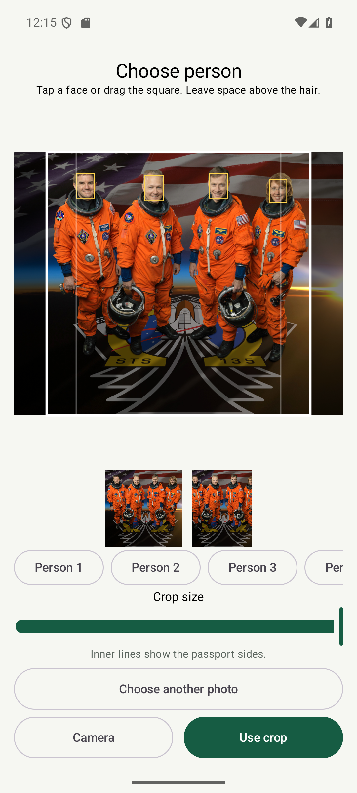
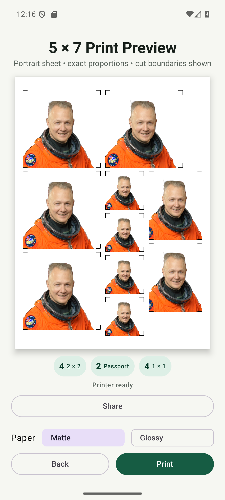
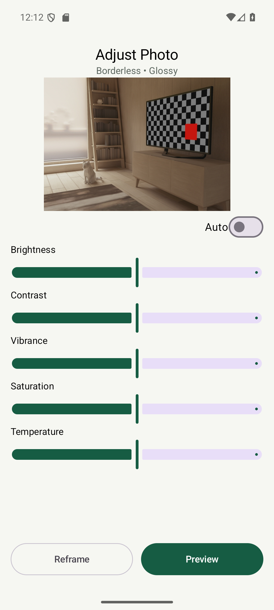

# Rene'R Studio

[](https://github.com/tatselkrik/rene-r-id-print/actions/workflows/android-quality.yml)
[](https://github.com/tatselkrik/rene-r-id-print/releases/latest)

An Android photo workspace for Rene'R's in-house printing service. Capture or open a photo, prepare an ID sheet or a full-page landscape image, adjust its appearance, and print directly to an Epson EcoTank L15150 over local Wi-Fi.

**Current version:** 1.0.7 (build 11) · **Platform:** Android 6.0+ · **Distribution:** Signed APK

[Download APK](https://github.com/tatselkrik/rene-r-id-print/releases/download/v1.0.7/ReneR-Studio-v1.0.7.apk) · [User guide](docs/user-guide-v1.0.7.md) · [Release log](#release-log) · [Application tour](#application-tour) · [Developer setup](#developer-setup)

## What's new in 1.0.7

- **Rene'R Studio** branding and an opening choice between **ID Photo** and **Landscape Photo**.
- Landscape capture and photo import, with a movable 7:5 crop, pinch gestures and a zoom slider. Minimum zoom fills the page; zooming in trims unwanted edges.
- Landscape adjustments retain the original scene. Auto, Brightness, Contrast, Vibrance, Saturation and Temperature remain available; white-background replacement belongs only to IDs.
- A remembered **Matte / Glossy** choice in Printer Setup and immediately above Print in both final previews.
- Full-page landscape JPEGs and direct-print requests for landscape orientation, fill scaling and zero margins.
- Stable crop controls when a low-resolution warning appears, and corrected clipping of the landscape camera preview.

The established ID framing, checks, eight layouts and size/color calibration are retained. See [CHANGELOG.md](CHANGELOG.md) for the complete notes.

## Two photo workflows

| | ID Photo | Landscape Photo |
| --- | --- | --- |
| Input | Single/Group camera capture or Open Photo | Camera capture or Open Photo |
| Crop | Adjustable person selection for groups/imports; square and narrower passport previews | Movable 7:5 crop with drag, pinch and zoom |
| Finishing | Optional white background, Auto and five sliders | Original background, Auto and five sliders |
| Checks | Face, eyes, framing, head angle, sharpness and resolution | Advisory resolution warning; no ID face checks |
| Output | Portrait 5×7 sheet with ID photos and corner cutting guides | Landscape 7×5 image filling the page, with no added margins or cutting guides |
| Paper | Remembered Matte / Glossy | Same remembered Matte / Glossy choice |

## Core capabilities

- **Capture or import:** use the camera or Android's photo/file picker, including single-person and group images.
- **Choose a person:** face suggestions provide starting points; manual crop positioning preserves headroom and allows another person to be selected from the same source.
- **Keep the original:** new camera photos automatically save to the phone album before editing. Imported originals stay unchanged.
- **Adjust consistently:** non-destructive edits appear in crop previews, the finished JPEG and printing.
- **Use eight ID layouts:** combine 2×2-inch, 35×45 mm passport-size and 1×1-inch photos on one sheet.
- **Reconnect automatically:** the app checks its saved printer on opening, returning to the foreground and Wi-Fi changes.
- **Share or print:** Android sharing exports the finished JPEG; encrypted IPPS sends it directly to the local printer.

## Installation and updates

1. Download **[ReneR-Studio-v1.0.7.apk](https://github.com/tatselkrik/rene-r-id-print/releases/download/v1.0.7/ReneR-Studio-v1.0.7.apk)** from the [v1.0.7 release](https://github.com/tatselkrik/rene-r-id-print/releases/tag/v1.0.7).
2. Open it on the phone, allow installation from that source if Android asks, and install the update.
3. Connect the phone and L15150 to the same local network, normally the same Wi-Fi. Open the app and check for **Printer ready**.

Version 1.0.7 updates v1.0.3 and later, including earlier v1.0.7 test builds, without uninstalling. The displayed name changes from Rene'R ID Print to Rene'R Studio; the application identifier and signing identity remain the same. Versions 1.0.0–1.0.2 used the original key and require uninstalling first. Preserve needed photos before uninstalling; private settings and cache are cleared.

The app is distributed through GitHub Releases, not Google Play. Updates are installed manually. Each release includes an APK checksum. Android Studio is needed only for development.

## From photo to print

**ID:** choose ID Photo → Single or Group / Open Photo → frame or select a person → Automatic Check and adjustments → Layout → Preview → choose paper → Print or Share.

**Landscape:** choose Landscape Photo → Take Photo or Open Photo → drag and zoom the crop → Preview → adjustments → Preview → choose paper → Print or Share.

Camera originals save under **Pictures / ReneR ID Print**. The existing album name is retained across the app rename. There is no final Save button: **Share** exports the finished image, while automatic saving preserves the untouched camera original.

The phone and printer need local network access to each other; internet is not required. If automatic discovery needs help, open **Printer Setup** and connect by address. See the [user guide](docs/user-guide-v1.0.7.md) for framing, paper selection and troubleshooting.

## Output and printer behavior

The default ID layout contains **4 × 2×2, 2 × passport and 4 × 1×1** photos. All eight presets use fixed millimetre coordinates:

| 2×2-inch | Passport 35×45 mm | 1×1-inch |
| ---: | ---: | ---: |
| 6 | 0 | 0 |
| 4 | 2 | 4 |
| 4 | 0 | 8 |
| 2 | 6 | 0 |
| 2 | 4 | 6 |
| 2 | 2 | 8 |
| 0 | 8 | 4 |
| 0 | 6 | 8 |

ID JPEGs are **3000×4200** pixels; landscape JPEGs are **4200×3000** pixels. Both carry **600 dpi** metadata for 5×7-inch paper. A large exported pixel count does not recover detail missing from a low-resolution source.

Direct printing targets the established L15150/Cassette 1 workflow at high quality. ID printing retains the measured RC Woven matte size correction (about 106.0% horizontal and 105.9% vertical). The established warmer direct-print color treatment remains in both modes; shared JPEGs do not receive printer calibration.

Landscape requests fill scaling, landscape orientation and zero margins, using a borderless 5×7 media keyword when advertised. Unsupported requested settings produce an error rather than a silent bordered fallback. **Actual edge coverage, orientation and Matte/Glossy paper compatibility still require a physical L15150 test for the new landscape workflow.** Glossy-specific color recalibration was intentionally deferred.

## Release log

This table lists version milestones; local development and validation builds are consolidated under their version. Dates use Philippine local time. Versions 1.0.0–1.0.2 are preserved historical Git tags; downloadable GitHub releases start at 1.0.3.

| Version | Date | Summary |
| --- | --- | --- |
| [1.0.7](CHANGELOG.md#107---2026-10-13) | 2026-10-13 | Rene'R Studio, landscape capture/import and full-page output, remembered Matte/Glossy, current screenshot tour |
| [1.0.6](CHANGELOG.md#106---2026-10-02) | 2026-10-02 | Photo import, group/person selection, automatic original saving and simpler final actions |
| [1.0.5](CHANGELOG.md#105---2026-09-23) | 2026-09-23 | Camera guide-to-JPEG framing correction across A14 5G and S24 FE |
| [1.0.4](CHANGELOG.md#104---2026-09-22) | 2026-09-22 | Compact photo adjustments, Auto reset behavior and consistent adjusted output |
| [1.0.3](CHANGELOG.md#103---2026-09-14) | 2026-09-14 | Automatic printer connection, encrypted printing, crop-containment checks and automatic signing |
| [1.0.2](CHANGELOG.md#102---2026-08-06) | 2026-08-06 | Eight fixed-dimension ID layouts and combination selection |
| [1.0.1](CHANGELOG.md#101---2026-08-06) | 2026-08-06 | White-background finishing, shadow lifting and direct-print color correction |
| [1.0.0](CHANGELOG.md#100---2026-08-05) | 2026-08-05 | Guided ID capture, face checks, JPEG output and direct Wi-Fi printing |

See the [full release history](CHANGELOG.md) and [GitHub Releases](https://github.com/tatselkrik/rene-r-id-print/releases) for version-specific notes and installers. Earlier notes describe the behavior at that time, including the former app name and Save action.

## Application tour

These are actual v1.0.7 emulator screenshots from the layout checks, using demonstration images rather than customer photos. Expand a screen to view it. Printer-ready labels in this tour demonstrate the interface; they are not evidence of a physical print. [Screenshot sources and scope](docs/screenshots/README.md).

<details>
<summary><strong>1. Home — ID or Landscape</strong></summary>


</details>

<details>
<summary><strong>2. ID camera — Single, Group or Open Photo</strong></summary>


</details>

<details>
<summary><strong>3. Group photo — choose and frame a person</strong></summary>

Tap a face or a Person button, then position and resize the square. The numbered person row scrolls horizontally.



</details>

<details>
<summary><strong>4. ID review — Background, Auto and adjustments</strong></summary>


</details>

<details>
<summary><strong>5. Layout — eight ID combinations</strong></summary>


</details>

<details>
<summary><strong>6. ID preview — paper choice before Print</strong></summary>



</details>

<details>
<summary><strong>7. Landscape camera — capture a wide image</strong></summary>


</details>

<details>
<summary><strong>8. Landscape crop — drag and zoom to fill</strong></summary>


</details>

<details>
<summary><strong>9. Landscape adjustments — preserve the original scene</strong></summary>



</details>

<details>
<summary><strong>10. Landscape preview — full-page image and Glossy selection</strong></summary>


</details>

The [earlier walkthrough](docs/historical-ui.md) is retained separately for historical reference.

## Privacy and scope

Face detection, segmentation, checks and adjustments run on the phone. The app has no photo-cloud upload workflow. Camera originals stay in the phone album until the operator deletes them; imported originals stay unchanged. Working images and temporary sheets use private app cache. Share sends the finished image through the Android app the operator selects; Print sends it to the local printer.

Printing uses encrypted IPPS with a saved printer-certificate pin. Initial pairing trusts the certificate presented on the local network; subsequent connections must match it. A changed certificate requires an explicit reconnect in Printer Setup. There is no silent unencrypted fallback.

The public repository includes source, documentation and reviewed demonstration screenshots. Private signing keys, credentials, local device configuration, customer photos, build output and task-checkpoint files are excluded. Signed installers are distributed as release assets.

The project targets one established 5×7-inch L15150 workflow. Other paper sizes/printers, remote internet printing, automated photo retention and authority-specific passport certification are outside the current implementation. Automated ID checks assist the operator; they do not certify passport compliance or detect every hair boundary.

## Documentation

| Document | Purpose |
| --- | --- |
| [User guide — v1.0.7](docs/user-guide-v1.0.7.md) | Installation, ID and landscape workflows, adjustments, paper and troubleshooting |
| [Release history](CHANGELOG.md) | Version milestones, retained behavior and verification limits |
| [Screenshot notes](docs/screenshots/README.md) | Current gallery inventory, demo sources and privacy boundary |
| [Git and Release Guide](GIT_AND_RELEASE_GUIDE.md) | Branches, automatic signing and verified publication |
| [Historical walkthrough](docs/historical-ui.md) | Preserved screenshots of earlier interfaces |

## Developer setup

| Component | Project baseline |
| --- | --- |
| Language / UI | Kotlin / Jetpack Compose, BOM 2026.06.00 |
| Build | Gradle 9.1.0 / Android Gradle Plugin 9.0.1 |
| Android | Compile SDK 36.1, target 36, minimum 23 |
| Java | JDK 17 or a compatible Android Studio embedded JDK |
| Camera | CameraX 1.6.1 |
| On-device vision | ML Kit face detection 16.1.7 / selfie segmentation 16.0.0-beta6 (retained baseline) |
| Printer protocol | JIPP 0.7.18 over encrypted IPPS |
| Application ID | `com.idphoto.printing` (preserved for upgrades) |

Open this root project in Android Studio, install SDK Platform 36.1, compatible Build-Tools and Platform-Tools, and allow the first sync to download dependencies. Run the `app` configuration on a phone or emulator. Development builds use a different signing identity from the release installer.

```text
app/src/main/java/com/idphoto/printing/
├── analysis/   Face and sharpness checks
├── core/       Crop geometry, physical units and ID layouts
├── image/      Loading, original saving and adjustments
├── print/      JPEG rendering, paper profiles and IPPS
└── ui/         Capture, crop, review, preview and setup screens
app/src/test/   Unit tests
docs/           User guides and screenshot galleries
tools/          Local signed-installer helper
```

Verification on Windows, with the JDK configured:

```powershell
.\gradlew.bat testDebugUnitTest lintRelease assembleRelease
```

GitHub's Android quality workflow runs unit tests, debug lint and a debug build. Local v1.0.7 checks additionally covered the signed release installer and 32 emulator screenshot states at normal and larger-text settings; no offscreen or overlapping visible actions were found in the bounds audit. Physical proof of the new landscape print path remains pending.

The configured signing helper uses the permanent automatic key and a Windows-protected local credential without prompting for a password. Missing signing state fails rather than replacing the key. Private signing material must never enter Git or release assets. See the [release guide](GIT_AND_RELEASE_GUIDE.md) before preparing an installer.
