# Rene'R Studio

[](https://github.com/tatselkrik/rene-r-studio/actions/workflows/android-quality.yml)

An Android photo workspace for Rene'R's in-house printing service. Capture or open a photo, prepare an ID sheet or a full-page landscape image, adjust its appearance, and print directly to an Epson EcoTank L15150 over local Wi-Fi.

**Current version:** 1.0.12 (build 16) · **Platform:** Android 6.0+ · **Distribution:** Local signed APK; source and documentation on GitHub

[User guide](docs/user-guide-v1.0.12.md) · [Release notes](#release-notes) · [Application tour](#application-tour) · [Developer setup](#developer-setup)

## What's new in 1.0.12

- **Landscape border choice:** select **Borderless** or **Bordered** on the final print preview. Borderless remains the default; the choice is remembered.
- **Bordered preview and printing:** view the white margins before printing. Bordered fits the complete crop inside normal margins, with either Matte or Glossy paper.

ASA camera shots and imports keep returning to the side-by-side editor. Single framing, optional Landscape white Background and ASA's four-copy horizontal 3×2 layout remain available. The signed APK remains local; source and documentation are maintained on GitHub. See the [release notes](CHANGELOG.md#1012---2026-10-28).

## Photo workflows

| | Single ID | ASA | Landscape Photo |
| --- | --- | --- | --- |
| Input | Single camera or Open Photo | Together or Separately; direct Take / Open per source | Camera or Open Photo |
| Framing | Square framing and narrower passport preview; no person picker | Automatic horizontal fit; optional whole-photo or independent framing | Movable 7:5 crop |
| Finishing | White Background, Auto and five sliders | Same Background, Auto and five sliders | Original or optional white background, Auto and five sliders |
| Checks | Face, eyes, framing, head angle, sharpness and resolution | Advisory resolution warning; no person identification or single-face checks | Advisory resolution warning |
| Output | One of eight ID layouts on portrait 5×7 | Only four 3×2 photos on 5×7, with cutting guides | Landscape 7×5, Borderless or Bordered |
| Paper | Remembered Matte / Glossy | Same remembered paper choice | Same remembered paper choice |

## Core capabilities

- **Capture or import:** use the camera or Android's photo/file picker, including single-person and group images.
- **Single framing:** position the square and inspect its passport preview without selecting or identifying a person.
- **Prepare two people:** ASA supports a shared upper-chest shot or two independently framed photos with left/right placement.
- **Keep the original:** new camera photos automatically save to the phone album before editing. Imported originals stay unchanged.
- **Adjust consistently:** non-destructive edits appear in crop previews, the finished JPEG and printing.
- **Use eight ID layouts:** combine 2×2-inch, 35×45 mm passport-size and 1×1-inch photos on one sheet.
- **Reconnect automatically:** the app checks its saved printer on opening, returning to the foreground and Wi-Fi changes.
- **Share or print:** Android sharing exports the finished JPEG; encrypted IPPS sends it directly to the local printer.

## Installation and updates

The signed APK and matching checksum for this build are kept locally; there is no public installer upload for v1.0.12.

1. Obtain **ReneR-Studio-v1.0.12.apk** and its matching checksum from the maintainer.
2. Open it on the phone, allow installation from that source if Android asks, and install the update.
3. Connect the phone and L15150 to the same local network, normally the same Wi-Fi. Open the app and check for **Printer ready**.

Install over the existing release to retain private settings. The application identifier and signing identity are unchanged. If Android reports a signature conflict, preserve needed photos and consult the [release guide](GIT_AND_RELEASE_GUIDE.md) before uninstalling.

This build is distributed as a local signed APK, with manual installation and a matching checksum. Android Studio is needed only for development or building from source.

## From photo to print

**Single:** choose ID Photo → Single / Open Photo → frame the photo → Automatic Check and adjustments → Layout → Preview → choose paper → Print or Share.

**ASA:** choose ID Photo → ASA → Together or Separately → take/open the photo(s) → use automatic fitting or optional Adjust framing → Preview → Background, Auto and adjustments → Preview → choose paper → Print or Share. Separately opens the two-slot editor. Use Open 1 / Open 2 for files or Take 1 / Take 2 for camera shots, then choose left/right positions. Imported files stay in this editor.

**Landscape:** choose Landscape Photo → Take Photo or Open Photo → drag and zoom the crop → Preview → adjustments → Preview → choose Borderless / Bordered and paper → Print or Share.

Camera originals save under **Pictures / ReneR ID Print**. The existing album name is retained across the app rename. There is no final Save button: **Share** exports the finished image, while automatic saving preserves the untouched camera original.

The phone and printer need local network access to each other; internet is not required. If automatic discovery needs help, open **Printer Setup** and connect by address. See the [user guide](docs/user-guide-v1.0.12.md) for framing, paper selection and troubleshooting.

## Output and printer behavior

The default ID layout contains **4 × 2×2, 2 × passport and 4 × 1×1** photos. All eight presets use fixed millimetre coordinates:

| 2×2-inch | Passport 35×45 mm | 1×1-inch |
| ---: | ---: | ---: |
| 6 | 0 | 0 |
| 4 | 2 | 4 |
| 4 | 0 | 8 |
| 2 | 6 | 0 |
| 2 | 4 | 6 |
| 2 | 2 | 8 |
| 0 | 8 | 4 |
| 0 | 6 | 8 |

ID and ASA JPEGs are **3000×4200** pixels; landscape JPEGs are **4200×3000** pixels. ASA photos are rotated on the portrait print sheet to retain the established printer path, while its on-screen sheet is shown sideways with upright photos. Both carry **600 dpi** metadata for 5×7-inch paper. A large exported pixel count does not recover detail missing from a low-resolution source.

Direct printing targets the established L15150/Cassette 1 workflow at high quality. Single and ASA printing retain the measured RC Woven matte size correction (about 106.0% horizontal and 105.9% vertical). The established warmer direct-print color treatment remains in all workflows; shared JPEGs do not receive printer calibration.

Landscape defaults to **Borderless**: fill scaling, landscape orientation and zero margins, using a borderless 5×7 media keyword when advertised. **Bordered** uses regular 5×7 media, requests 3 mm printer margins and fits the full crop inside them; fitting can leave wider margins on two edges. Both modes retain the same paper choice and direct-print color correction. Share exports the adjusted full-crop JPEG without printer margins. Unsupported requested settings produce an error rather than a silent mode change. **Actual border widths, edge coverage, orientation and Matte/Glossy paper compatibility still require a physical L15150 test.** Glossy-specific color recalibration was intentionally deferred.

## Release notes

| Version | Date | Summary |
| --- | --- | --- |
| [1.0.12](CHANGELOG.md#1012---2026-10-28) | 2026-10-28 | Remembered Borderless / Bordered Landscape printing and margin preview |

See the [detailed notes](CHANGELOG.md#1012---2026-10-28) for changes and verification limits. The signed installer and checksum remain local. Source and release logs are published in version order; physical phone/printer results remain unverified.

## Application tour

The gallery uses reviewed demonstration images. ASA, its mode entry and the Landscape border preview use current captures; unchanged examples are retained from the approved gallery. Expand a screen to view it. Printer-ready labels illustrate the interface and do not establish a physical print result. [Screenshot sources and scope](docs/screenshots/current/README.md).

<details>
<summary><strong>1. Home — ID or Landscape</strong></summary>

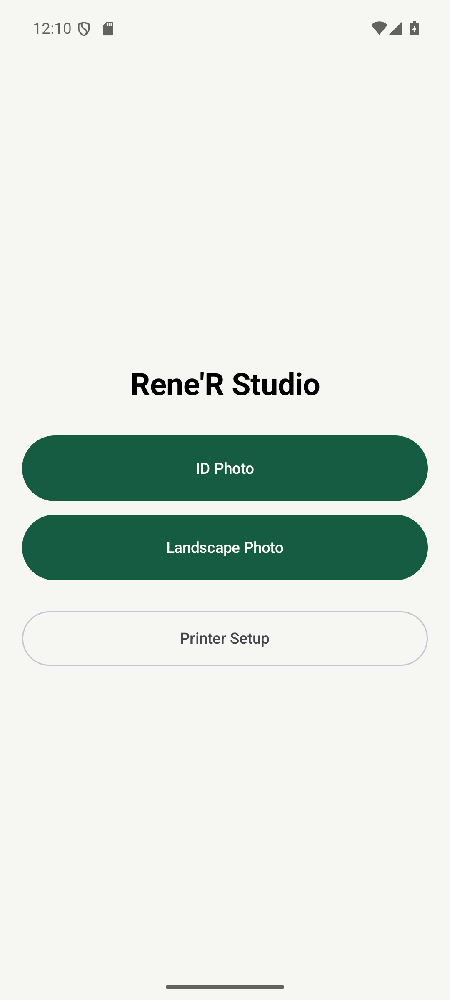

</details>

<details>
<summary><strong>2. ID camera — Single, ASA or Open Photo</strong></summary>

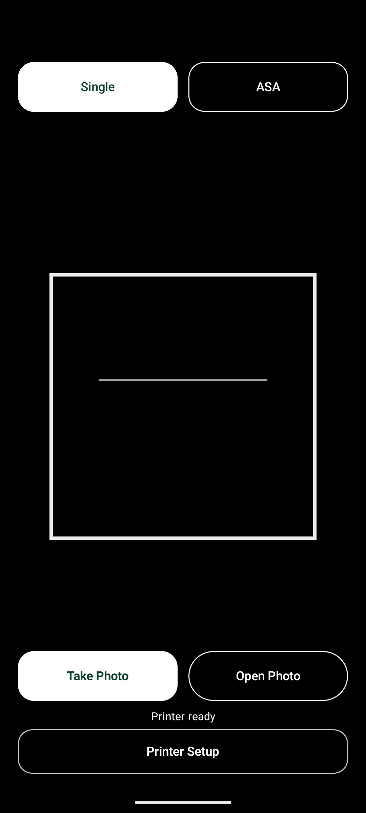

</details>

<details>
<summary><strong>3. Single import — adjust framing</strong></summary>

Position and resize the square, preserving headroom and checking the passport side guides. Single has no person buttons or face-selection boxes.

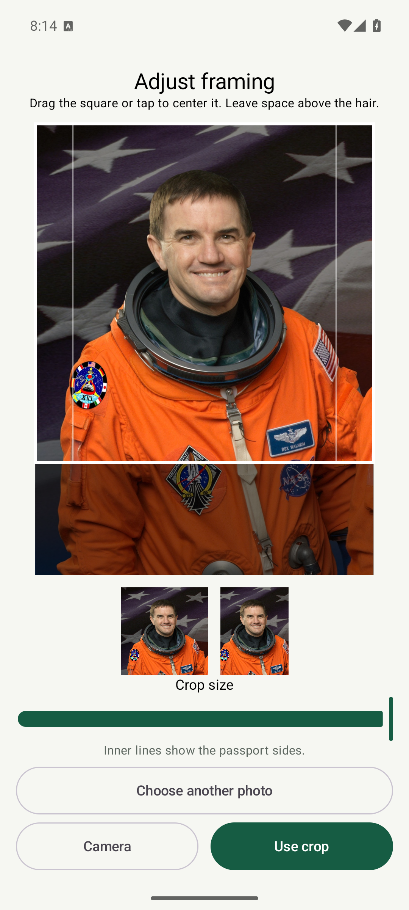

</details>

<details>
<summary><strong>4. ID review — Background, Auto and adjustments</strong></summary>

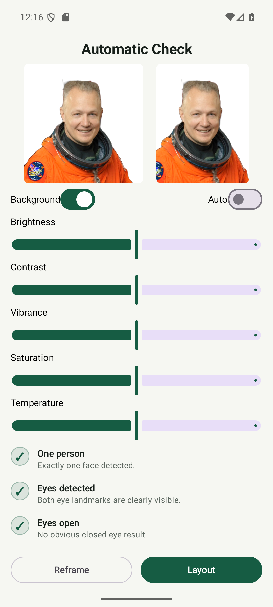

</details>

<details>
<summary><strong>5. Layout — eight ID combinations</strong></summary>

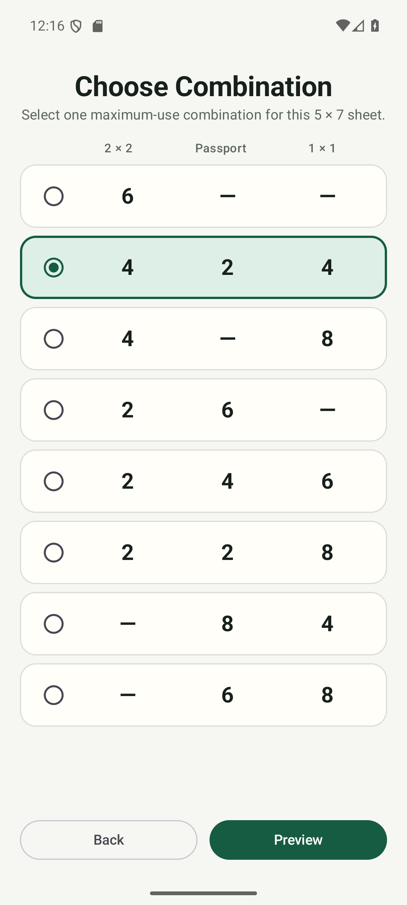

</details>

<details>
<summary><strong>6. ID preview — paper choice before Print</strong></summary>


</details>

<details>
<summary><strong>7. Landscape camera — capture a wide image</strong></summary>

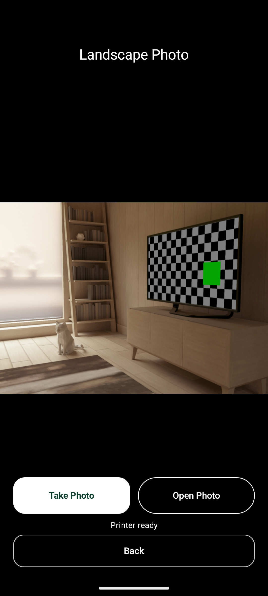

</details>

<details>
<summary><strong>8. Landscape crop — drag and zoom to fill</strong></summary>

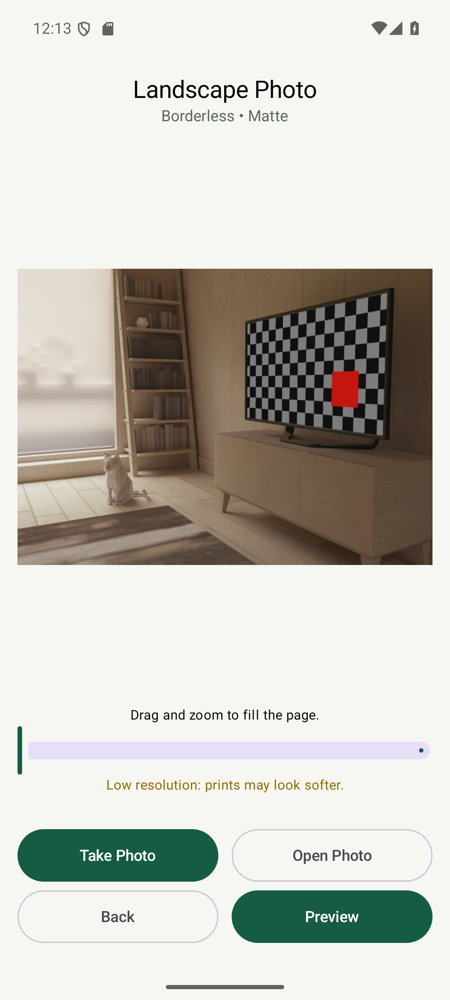

</details>

<details>
<summary><strong>9. Landscape adjustments — original or white background</strong></summary>


</details>

<details>
<summary><strong>10. Landscape preview — Borderless / Bordered and paper selection</strong></summary>

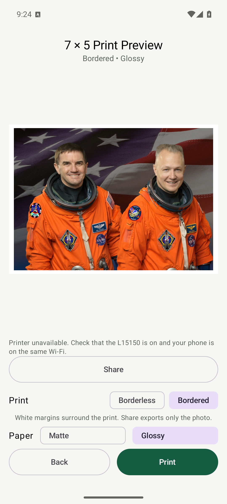

</details>

<details>
<summary><strong>ASA — Together or Separately</strong></summary>

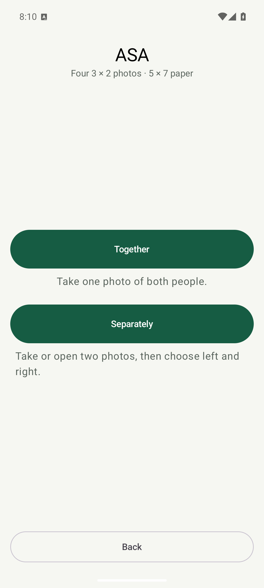

</details>

<details>
<summary><strong>ASA — two photos and left/right placement</strong></summary>

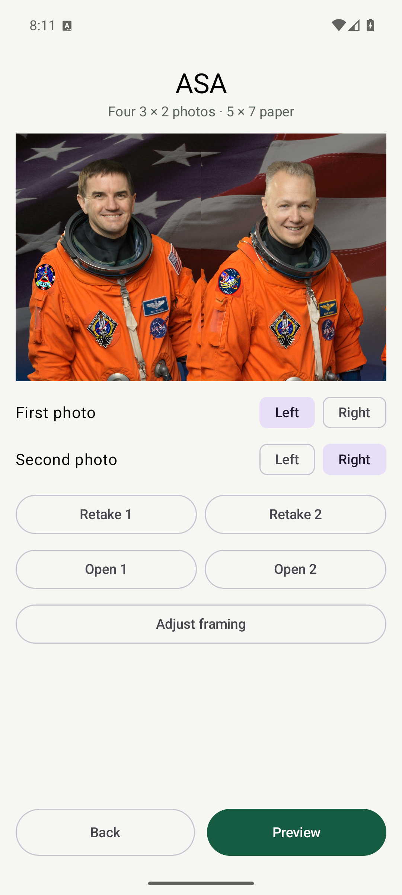

</details>

<details>
<summary><strong>ASA — white background and adjustments</strong></summary>

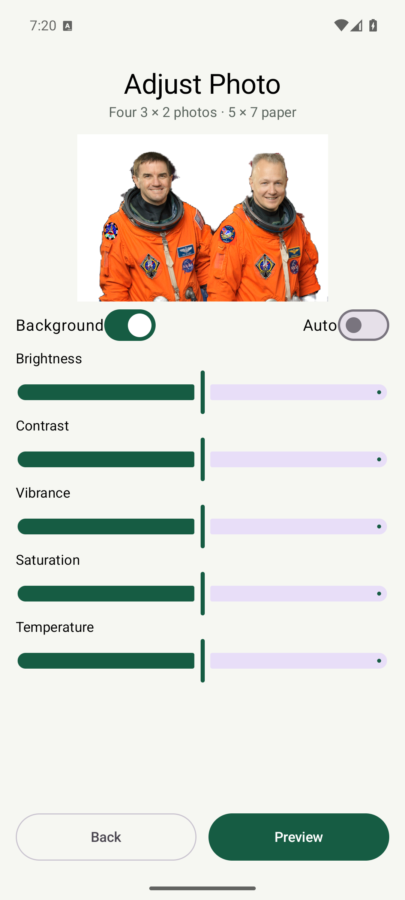

</details>

<details>
<summary><strong>ASA — four horizontal 3 by 2 photos</strong></summary>

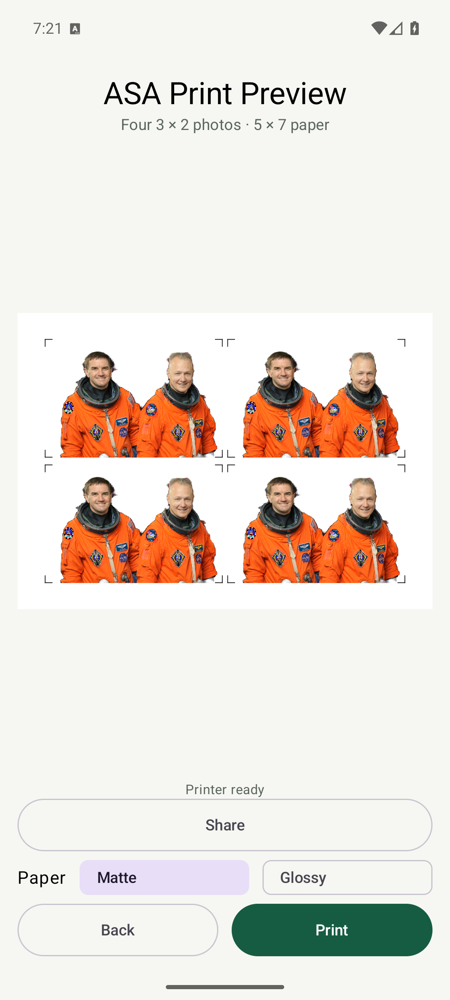

</details>

## Privacy and scope

Face detection, segmentation, checks and adjustments run on the phone. The app has no photo-cloud upload workflow. Camera originals stay in the phone album until the operator deletes them; imported originals stay unchanged. Working images and temporary sheets use private app cache. Share sends the finished image through the Android app the operator selects; Print sends it to the local printer.

Printing uses encrypted IPPS with a saved printer-certificate pin. Initial pairing trusts the certificate presented on the local network; subsequent connections must match it. A changed certificate requires an explicit reconnect in Printer Setup. There is no silent unencrypted fallback.

The public repository includes source, documentation and reviewed demonstration screenshots. Private signing keys, credentials, local device configuration, customer photos, build output and task-checkpoint files are excluded. The signed installer and checksum are kept outside Git in the ignored local release directory.

The project targets one established 5×7-inch L15150 workflow. Other paper sizes/printers, remote internet printing, automated photo retention and authority-specific passport certification are outside the current implementation. Automated ID checks assist the operator; they do not certify passport compliance or detect every hair boundary.

## Documentation

| Document | Purpose |
| --- | --- |
| [User guide — v1.0.12](docs/user-guide-v1.0.12.md) | Installation, Single/ASA/Landscape workflows, adjustments, paper and troubleshooting |
| [Release history](CHANGELOG.md) | Version milestones, retained behavior and verification limits |
| [Screenshot notes](docs/screenshots/current/README.md) | Current gallery inventory, demo sources and privacy boundary |
| [Git and Release Guide](GIT_AND_RELEASE_GUIDE.md) | Branches, automatic signing and verified publication |

## Developer setup

| Component | Project baseline |
| --- | --- |
| Language / UI | Kotlin / Jetpack Compose, BOM 2026.06.00 |
| Build | Gradle 9.1.0 / Android Gradle Plugin 9.0.1 |
| Android | Compile SDK 36.1, target 36, minimum 23 |
| Java | JDK 17 or a compatible Android Studio embedded JDK |
| Camera | CameraX 1.6.1 |
| On-device vision | ML Kit face detection 16.1.7 / selfie segmentation 16.0.0-beta6 (retained baseline) |
| Printer protocol | JIPP 0.7.18 over encrypted IPPS |
| Application ID | `com.idphoto.printing` (preserved for upgrades) |

Open this root project in Android Studio, install SDK Platform 36.1, compatible Build-Tools and Platform-Tools, and allow the first sync to download dependencies. Run the `app` configuration on a phone or emulator. Development builds use a different signing identity from the release installer.

```text
app/src/main/java/com/idphoto/printing/
├── analysis/   Face and sharpness checks
├── core/       Crop geometry, physical units and ID layouts
├── image/      Loading, original saving and adjustments
├── print/      JPEG rendering, paper profiles and IPPS
└── ui/         Capture, crop, review, preview and setup screens
app/src/test/   Unit tests
docs/           User guides and screenshot galleries
tools/          Signed-installer helper and safety regression checks
```

Verification on Windows, with the JDK configured:

```powershell
.\gradlew.bat testDebugUnitTest lintRelease assembleRelease
powershell -ExecutionPolicy Bypass -File .\tools\test-installer-safety.ps1
```

GitHub's Android quality workflow runs unit tests, debug lint and a debug build. Local verification includes 95 unit tests, debug/release assembly, release lint, installer signature/package/version checks, and a signed upgrade over the prior local candidate. Emulator checks cover both border previews, remembered settings after restart, independent paper selection, the sharing panel and controls at 411 dp/default text and 360 dp/1.2 text scale. ASA capture/import and JPEG-rendering source remain unchanged from the previously tested candidate. Installer-safety regression checks also run in CI. Physical ASA phone/printer acceptance remains pending; landscape border widths, edge coverage, orientation and paper compatibility still need an L15150 sample print.

The configured signing helper uses the permanent automatic key and a Windows-protected local credential without prompting for a password. Missing signing state fails rather than replacing the key. Private signing material must never enter Git or release assets. See the [release guide](GIT_AND_RELEASE_GUIDE.md) before preparing an installer.
